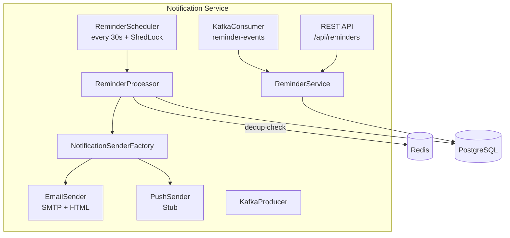

# Notification Microservice — Walkthrough

## What Was Built

A production-ready notification microservice for the Flux Calendar application. It polls for pending reminders, sends notifications (Email + Push), handles retries, and prevents duplicates.

## Architecture



## Files Created (26 source files)

| Layer | Files |
|-------|-------|
| **Entity** | [Reminder.java](file:///home/maxvpire/Desktop/Flux-cal/services/notification-service/src/main/java/com/flux/notification_service/reminder/Reminder.java), [ReminderType.java](file:///home/maxvpire/Desktop/Flux-cal/services/notification-service/src/main/java/com/flux/notification_service/reminder/ReminderType.java), [ReminderStatus.java](file:///home/maxvpire/Desktop/Flux-cal/services/notification-service/src/main/java/com/flux/notification_service/reminder/ReminderStatus.java) |
| **Repository** | [ReminderRepository.java](file:///home/maxvpire/Desktop/Flux-cal/services/notification-service/src/main/java/com/flux/notification_service/reminder/ReminderRepository.java) |
| **Service** | [ReminderService.java](file:///home/maxvpire/Desktop/Flux-cal/services/notification-service/src/main/java/com/flux/notification_service/reminder/ReminderService.java), [ReminderMapper.java](file:///home/maxvpire/Desktop/Flux-cal/services/notification-service/src/main/java/com/flux/notification_service/reminder/ReminderMapper.java) |
| **Processor** | [ReminderProcessor.java](file:///home/maxvpire/Desktop/Flux-cal/services/notification-service/src/main/java/com/flux/notification_service/processor/ReminderProcessor.java), [ReminderScheduler.java](file:///home/maxvpire/Desktop/Flux-cal/services/notification-service/src/main/java/com/flux/notification_service/processor/ReminderScheduler.java) |
| **Notification** | [NotificationSender.java](file:///home/maxvpire/Desktop/Flux-cal/services/notification-service/src/main/java/com/flux/notification_service/notification/NotificationSender.java), [NotificationPayload.java](file:///home/maxvpire/Desktop/Flux-cal/services/notification-service/src/main/java/com/flux/notification_service/notification/NotificationPayload.java), [NotificationSenderFactory.java](file:///home/maxvpire/Desktop/Flux-cal/services/notification-service/src/main/java/com/flux/notification_service/notification/NotificationSenderFactory.java), [EmailNotificationSender.java](file:///home/maxvpire/Desktop/Flux-cal/services/notification-service/src/main/java/com/flux/notification_service/notification/EmailNotificationSender.java), [PushNotificationSender.java](file:///home/maxvpire/Desktop/Flux-cal/services/notification-service/src/main/java/com/flux/notification_service/notification/PushNotificationSender.java) |
| **Kafka** | [ReminderEvent.java](file:///home/maxvpire/Desktop/Flux-cal/services/notification-service/src/main/java/com/flux/notification_service/kafka/ReminderEvent.java), [ReminderEventProducer.java](file:///home/maxvpire/Desktop/Flux-cal/services/notification-service/src/main/java/com/flux/notification_service/kafka/ReminderEventProducer.java), [ReminderEventConsumer.java](file:///home/maxvpire/Desktop/Flux-cal/services/notification-service/src/main/java/com/flux/notification_service/kafka/ReminderEventConsumer.java) |
| **API** | [ReminderController.java](file:///home/maxvpire/Desktop/Flux-cal/services/notification-service/src/main/java/com/flux/notification_service/reminder/ReminderController.java), [ReminderRequest.java](file:///home/maxvpire/Desktop/Flux-cal/services/notification-service/src/main/java/com/flux/notification_service/reminder/dto/ReminderRequest.java), [ReminderResponse.java](file:///home/maxvpire/Desktop/Flux-cal/services/notification-service/src/main/java/com/flux/notification_service/reminder/dto/ReminderResponse.java) |
| **Config** | [AppConfig.java](file:///home/maxvpire/Desktop/Flux-cal/services/calendar-service/src/main/java/com/flux/calendar_service/config/AppConfig.java), [SchedulerConfig.java](file:///home/maxvpire/Desktop/Flux-cal/services/notification-service/src/main/java/com/flux/notification_service/config/SchedulerConfig.java), [RedisConfig.java](file:///home/maxvpire/Desktop/Flux-cal/services/calendar-service/src/main/java/com/flux/calendar_service/config/RedisConfig.java) |
| **Exception** | [GlobalExceptionHandler.java](file:///home/maxvpire/Desktop/Flux-cal/services/notification-service/src/main/java/com/flux/notification_service/exception/GlobalExceptionHandler.java), [ReminderNotFoundException.java](file:///home/maxvpire/Desktop/Flux-cal/services/notification-service/src/main/java/com/flux/notification_service/exception/ReminderNotFoundException.java), [DuplicateReminderException.java](file:///home/maxvpire/Desktop/Flux-cal/services/notification-service/src/main/java/com/flux/notification_service/exception/DuplicateReminderException.java) |
| **DB Migrations** | [V1__create_reminders_table.sql](file:///home/maxvpire/Desktop/Flux-cal/services/notification-service/src/main/resources/db/migration/V1__create_reminders_table.sql), [V2__create_shedlock_table.sql](file:///home/maxvpire/Desktop/Flux-cal/services/notification-service/src/main/resources/db/migration/V2__create_shedlock_table.sql) |
| **Infra** | [Dockerfile](file:///home/maxvpire/Desktop/Flux-cal/services/calendar-service/Dockerfile), [notification-service.yml](file:///home/maxvpire/Desktop/Flux-cal/services/flux-config-server/src/main/resources/configurations/notification-service.yml) (config server), [.env](file:///home/maxvpire/Desktop/Flux-cal/.env) updates |

## Test Results

```
Tests run: 11, Failures: 0, Errors: 0, Skipped: 0
BUILD SUCCESS
```

- **ReminderServiceTest** (6 tests): CRUD, duplicate detection, not-found handling
- **ReminderProcessorTest** (5 tests): success flow, dedup skip, retry increment, max-retry failure

## API Endpoints

| Method | Path | Description |
|--------|------|-------------|
| `POST` | `/api/reminders` | Create a reminder |
| `POST` | `/api/reminders/batch` | Create multiple reminders |
| `GET` | `/api/reminders/{id}` | Get reminder by ID |
| `GET` | `/api/reminders/event/{eventId}` | List reminders for event |
| `DELETE` | `/api/reminders/{id}` | Delete a reminder |
| `DELETE` | `/api/reminders/event/{eventId}` | Delete all for event |

## How to Run

1. Ensure infrastructure is running: `docker-compose up -d` (Postgres, Redis, Kafka)
2. Create the `notificationdb` database on your Neon/Postgres instance
3. Start Config Server → Discovery Service → Notification Service:
   ```bash
   cd services/notification-service
   ./mvnw spring-boot:run
   ```
4. Test with:
   ```bash
   curl -X POST http://localhost:8084/api/reminders \
     -H "Content-Type: application/json" \
     -d '{"eventId":"evt-1","userId":"user-1","triggerTime":"2026-03-24T09:00:00Z","type":"EMAIL"}'
   ```

---

## Calendar-Service Integration Guidance

To fully integrate the notification service with your calendar-service, here's what needs to happen:

### Option A: Kafka-Based (Recommended)
When events are created/updated/deleted in calendar-service, publish a [ReminderEvent](file:///home/maxvpire/Desktop/Flux-cal/services/notification-service/src/main/java/com/flux/notification_service/kafka/ReminderEvent.java#18-47) to the `reminder-events` Kafka topic. The notification-service consumer will handle the rest.

Add to [EventService.java](file:///home/maxvpire/Desktop/Flux-cal/services/calendar-service/src/main/java/com/flux/calendar_service/event/EventService.java):

```java
// Inject KafkaTemplate
@Autowired
private KafkaTemplate<String, Object> kafkaTemplate;

// In createEvent(), after eventRepository.save():
kafkaTemplate.send("reminder-events", savedEvent.getId(), Map.of(
    "eventId", savedEvent.getId(),
    "userId", calendar.getUserId(),
    "eventTitle", savedEvent.getTitle(),
    "action", "CREATE",
    "reminders", List.of(
        Map.of("triggerTime", savedEvent.getStartTime().minus(15, ChronoUnit.MINUTES).toString(),
                "type", "EMAIL")
    )
));

// In deleteEvent():
kafkaTemplate.send("reminder-events", eventId, Map.of(
    "eventId", eventId,
    "action", "DELETE"
));
```

### Option B: REST-Based  
Call the notification service REST API directly from calendar-service:

```java
restTemplate.postForObject(
    "http://notification-service/api/reminders",
    new ReminderRequest(eventId, userId, triggerTime, "EMAIL"),
    ReminderResponse.class
);
```

### What the User Chooses
- **Default reminders**: 15 min before event (EMAIL)  
- **Custom reminders**: Let the frontend send reminder preferences with event creation, then forward to notification service
- **Reminder UI**: Add reminder selection to the event create/edit form in the frontend
